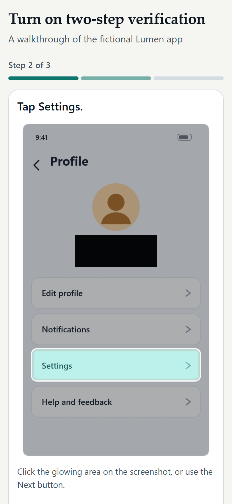

# TapTrail

**Turn screenshots into interactive, click-through tutorials. Private, free, no account.**

Add screenshots, draw a box around the thing to tap, write a short instruction, and download **one HTML file**. The person you send it to opens it in any browser, even offline, and follows the guide step by step.

### [Try it live: zuhairhalawa.github.io/TapTrail](https://zuhairhalawa.github.io/TapTrail/)

Version 0.1.0 · MIT license · runs entirely in your browser (no server, no upload, no analytics)


The sample on the landing page is a fictional app ("Lumen"). It runs on the same viewer that your own guides use, so you can try the experience before making anything.

## Who it is for

Everyday people explaining things to other people: showing a parent where a phone setting lives, walking a friend through an app, helping a student find a university portal page.

## How it works

1. **Add screenshots.** Choose, drag and drop, or paste with Ctrl+V (PNG, JPEG, WebP).
2. **Mark where to tap.** Draw a rectangle, move it, resize it, and write a short instruction. Cover private details with solid boxes.
3. **Send one file.** Export a self-contained `.html` guide. It opens offline and makes no network requests.

| Creator | Covering private details | Exported guide, opened offline |
| --- | --- | --- |
|  |  |  |

| Phone: landing page | Phone: editor | Phone: exported guide | Arabic (right-to-left) |
| --- | --- | --- | --- |
|  |  |  |  |

*All screenshots are taken from the deployed site by [`e2e/capture-screenshots.mts`](e2e/capture-screenshots.mts). They use only the fictional Lumen screens and made-up data; the covered name and email in the second screenshot are fictional.*

## Features

- **Creator studio**: name a guide, add screenshots, reorder / duplicate / delete steps, write an instruction per step.
- **Tap areas (hotspots)**: draw a rectangle, move it, resize it with handles, or do all of it from the keyboard (arrow keys move, Shift+arrows resize, Delete removes). Coordinates are stored as fractions of the image, so they stay accurate at every screen size.
- **Interactive viewer**: highlighted tap area, click it to advance, Back/Next buttons, progress bar, completion screen, restart, arrow-key navigation (direction-aware in RTL), reduced-motion support. Instructions are always readable even if a hotspot cannot be clicked.
- **Self-contained export**: one `.html` file with the screenshots, text, styles and viewer logic inside. No external scripts, styles, fonts or images; a strict Content-Security-Policy blocks all network access.
- **Project files**: export an editable `.taptrail.json`, import it again later or in another browser.
- **Print**: preview + browser Print produces a page with every step, screenshot and tap-area outline.
- **Manual redaction**: draw opaque boxes over private information. They are painted into the actual screenshot pixels on preview and export.
- **Metadata removal**: every upload is re-encoded in the browser, so EXIF / location / text chunks of the original file are not carried over.
- **Local drafts**: guides and images live in IndexedDB; resume after a reload; rename and delete (with confirmation); clear messages when browser storage is full or unavailable.
- **English and Arabic** interface with right-to-left layout; guides can be written in either language. Light and dark appearance.

## Privacy and redaction

- Nothing you add is uploaded. There is no backend, no account, no analytics. The only network traffic is loading the site itself.
- **Cover private info** draws solid black boxes. On preview and export the boxes are painted into the pixels of a fresh copy of the image. The uncovered pixels are not in the exported HTML or JSON, and the viewer contains no CSS overlay. Tests check this by decoding the exported image and sampling the covered pixels.
- TapTrail **does not detect** private information. You decide what to cover; check every screenshot before sharing.
- **Draft limitation:** until you press *Burn covered areas into this step* (or delete the guide), the draft stored in your browser still holds the original, uncovered screenshot. IndexedDB is not encrypted, and deleting data in a browser does not guarantee it is wiped from disk. Avoid working on sensitive guides on shared computers.
- Because redacted pixels are permanent in exports, the project JSON also contains only the covered pictures; importing it cannot restore what was covered.
- This is a small client-side tool, not a security product. See [SECURITY.md](SECURITY.md) for the threat model and known limits.

## Using the exported file

1. In the editor choose **Export → Download guide**.
2. Send the `.html` file as an email attachment, chat file or USB stick.
3. The other person double-clicks it. It works offline.

This shares a **file**, not a link. TapTrail does not host anything and has no public sharing URLs. Some email services reject attachments over 25 MB; TapTrail warns you when a file is that large.

## Accessibility

Semantic markup, visible keyboard focus, keyboard-operable tap areas and viewer, reduced-motion support, and automated axe-core checks (WCAG 2.0/2.1 A and AA rules, serious/critical issues) on the landing page in dark and light, the editor, and an exported guide. This is **not** a WCAG certification, and no screen-reader testing has been done.

## Run it locally

Requires Node.js 20+.

```bash
npm install
npm run dev          # http://localhost:5173/TapTrail/
```

Production build and preview (served under the GitHub Pages base path `/TapTrail/`):

```bash
npm run build
npm run preview      # http://127.0.0.1:4173/TapTrail/
```

## Testing

```bash
npm run typecheck
npm run lint
npm test                                          # Vitest: unit + component tests
npx playwright install chromium firefox webkit    # first time only
npm run test:e2e                                  # builds, serves, runs Playwright on every engine
npx playwright test --project=firefox             # one engine (desktop, firefox, webkit, mobile)
```

CI runs all of this on every push ([workflow](.github/workflows/ci.yml)), plus `npm audit`. The browser tests build a guide from screenshots, export it, open the exported file in a context with the network switched off, and check redaction, metadata removal, hostile text, bad files, full storage, Arabic RTL, keyboard operation, hotspot drag/resize and phone layouts.

## Deployment

GitHub Pages, deployed from GitHub Actions ([workflow](.github/workflows/pages.yml)) using only `contents: read`, `pages: write` and `id-token: write`. Only the built static site (`dist/`) is published. The app uses hash routes, so reloads work without server rewrites.

## Tech

React 19, TypeScript (strict), Vite, Tailwind CSS v4, IndexedDB via `idb`, Vitest + Testing Library, Playwright (+ axe-core). The viewer is a dependency-free vanilla JS module (`src/viewer/runtime.js`) shared by the app and inlined into exported files.

## Known limitations

- **Manual only.** No automatic screenshot recording, no AI-written instructions, no cloud sync, no accounts, no hosted links.
- One rectangular hotspot per step. Rectangles only.
- Up to 60 steps per guide, 15 MB per uploaded image; images are scaled so the longest side is at most 2000 px. Large guides make large HTML files.
- Drafts live in browser storage, which the user or the browser can clear. Export a project file now and then.
- TapTrail itself needs a connection to load. Only *exported guides* are designed to work offline; the app does not install a service worker.
- **Browser coverage:** automated tests run on Playwright's Chromium, Firefox and WebKit builds. WebKit is Playwright's engine, **not Safari**; nothing has been tested on real Safari, iOS or Android hardware, and the phone tests are emulation. Playwright can generate PDFs only in Chromium, so PDF output is not byte-checked elsewhere (the print layout itself is checked on every engine).
- The Arabic translation has not been reviewed by a native-speaking editor; corrections are welcome.
- Screenshots are re-encoded as WebP (quality 0.92) when the browser supports it, otherwise PNG.

## Contributing

Issues and pull requests are welcome. Please read [CONTRIBUTING.md](CONTRIBUTING.md) first; the short version is "no backend, no tracking, user content is untrusted, tests for what you change". Report security problems privately as described in [SECURITY.md](SECURITY.md).

## License

[MIT](LICENSE) © 2026 zuhairhalawa