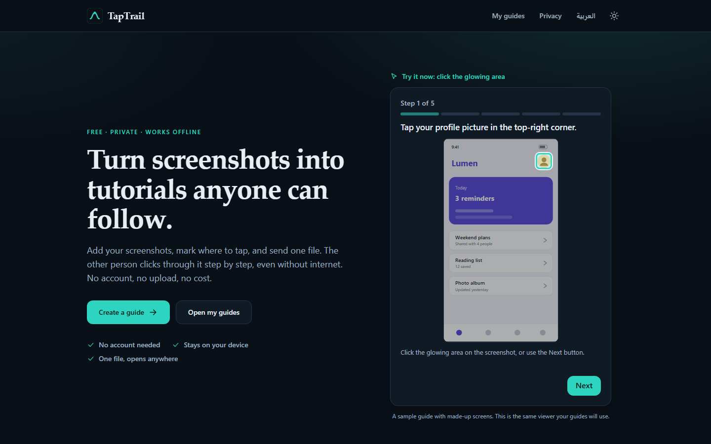
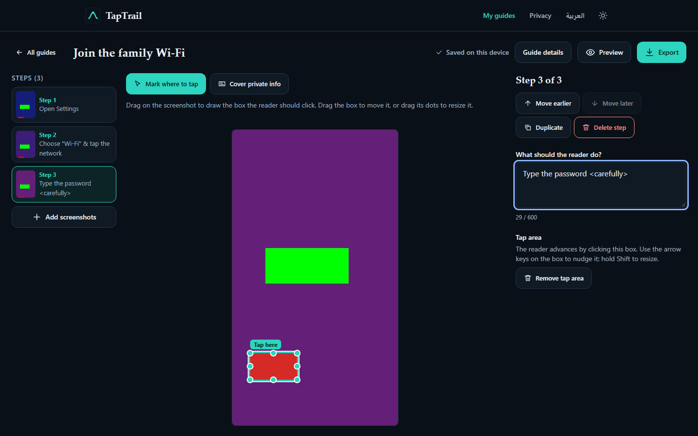
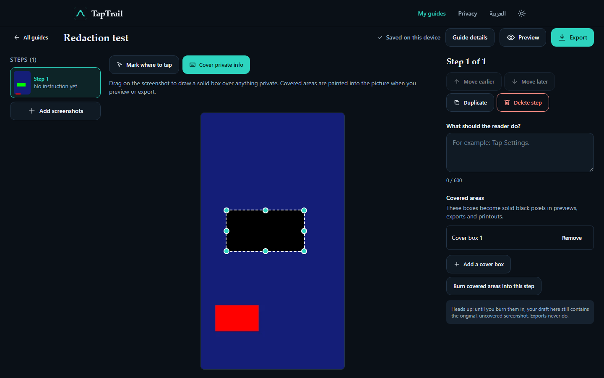
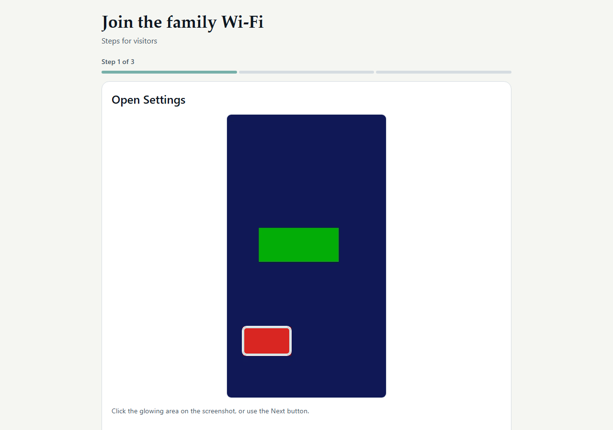
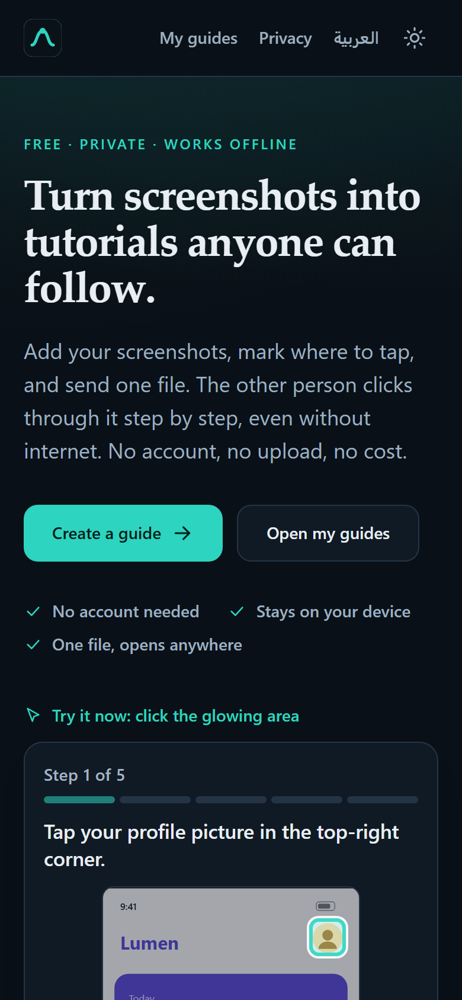
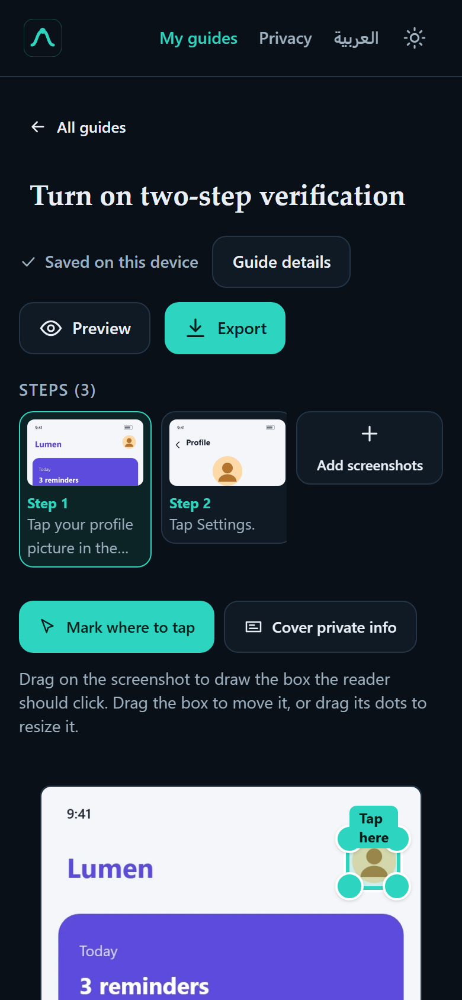
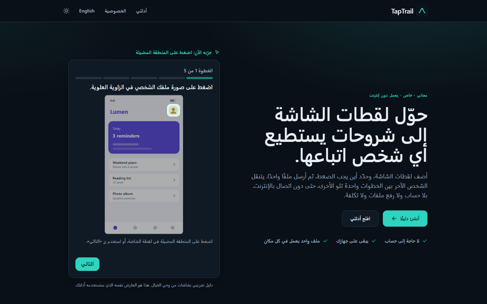

# TapTrail

**Turn screenshots into interactive, click-through tutorials. Private, free, no account.**

Add screenshots, draw a box around the thing to tap, write a short instruction, and download **one HTML file**. The person you send it to opens it in any browser, even offline, and follows the guide step by step.

Version 0.1.0 · MIT license · runs entirely in your browser (no server, no upload, no tracking)



## Who it is for

Everyday people explaining things to other people: showing a parent where a phone setting lives, walking a friend through an app, helping a student find a university portal page.

## Features

- **Creator studio**: name a guide, add PNG/JPEG/WebP screenshots (choose, drag and drop, or paste with Ctrl+V), reorder / duplicate / delete steps, write an instruction per step.
- **Tap areas (hotspots)**: draw a rectangle, move it, resize it with handles, or do all of it from the keyboard (arrow keys move, Shift+arrows resize, Delete removes). Coordinates are stored as fractions of the image, so they stay accurate at every screen size.
- **Interactive viewer**: highlighted hotspot, click it to advance, Back/Next buttons, progress bar, completion screen, restart, arrow-key navigation (direction-aware in RTL), reduced-motion support. Instructions are always readable even if a hotspot cannot be clicked.
- **Self-contained export**: one `.html` file with the screenshots, text, styles and viewer logic inside. No external scripts, styles, fonts or images; a strict Content-Security-Policy blocks all network access.
- **Project files**: export editable `.taptrail.json`, import it again later or in another browser.
- **Print**: preview + browser Print produces a page with every step, screenshot and hotspot outline.
- **Redaction**: draw opaque boxes over private information. They are painted into the actual screenshot pixels on preview/export.
- **Metadata removal**: every upload is re-encoded in the browser, so EXIF / location / text chunks of the original file are not carried over.
- **Local drafts**: guides and images live in IndexedDB; resume after a reload; rename and delete (with confirmation); clear messages when browser storage is full or unavailable.
- **English and Arabic** interface with correct right-to-left layout; guides can be written in either language.
- **Sample guide** with original, fictional screens ("Lumen") running on the same viewer as your guides.

| Creator | Redaction | Exported guide (offline) |
| --- | --- | --- |
|  |  |  |

| Mobile landing | Mobile editor | Arabic (RTL) |
| --- | --- | --- |
|  |  |  |

(All screenshots are captured from the real running app by the Playwright tests: `SHOTS=1 npm run test:e2e`.)

## Run it locally

Requires Node.js 20+.

```bash
npm install
npm run dev          # http://localhost:5173/TapTrail/
```

Production build and preview (served under the GitHub Pages base path `/TapTrail/`):

```bash
npm run build
npm run preview      # http://127.0.0.1:4173/TapTrail/
```

### Checks

```bash
npm run typecheck
npm run lint
npm test                              # Vitest: unit + component tests
npx playwright install chromium firefox webkit   # first time only
npm run test:e2e                      # builds, serves, runs Playwright (Chromium, Firefox, WebKit, mobile)
npx playwright test --project=firefox # a single engine
```

## Using the exported file

1. In the editor choose **Export → Download guide**.
2. Send the `.html` file as an email attachment, chat file or USB stick.
3. The other person double-clicks it. It works offline.

This shares a **file**, not a link. TapTrail does not host anything and has no public sharing URLs.
Some email services reject attachments over 25 MB; TapTrail warns you when a file is that large.

## Privacy and redaction

- Nothing you add is ever uploaded. There is no backend, no account, no analytics.
- **Cover private info** draws solid black boxes. On preview and export the boxes are painted into the pixels of a fresh copy of the image. The uncovered pixels are not in the exported HTML or JSON, and the viewer contains no CSS overlay.
- TapTrail **does not detect** private information. You decide what to cover; check every screenshot before sharing.
- **Draft limitation:** until you press *Burn covered areas into this step* (or delete the guide), the draft stored in your browser still holds the original, uncovered screenshot. IndexedDB is not encrypted, and deleting data in a browser does not guarantee it is wiped from disk. Avoid working on sensitive guides on shared computers.
- Because redacted pixels are permanent in exports, the project JSON also contains only the covered pictures; importing it cannot restore what was covered.

## Security

See [SECURITY.md](SECURITY.md). In short: all imports are validated and size-bounded, guide text is only ever written with `textContent`, exported data is embedded as inert escaped JSON, and exported files carry a hash-based CSP (`default-src 'none'; img-src data:`).

## Tech

React 19, TypeScript (strict), Vite, Tailwind CSS v4 (`@tailwindcss/vite`), IndexedDB via `idb`, Vitest + Testing Library, Playwright (+ axe-core). The viewer is a dependency-free vanilla JS module (`src/viewer/runtime.js`) shared by the app and inlined into exported files.

## Limits and honest limitations

- **Manual only.** No automatic screenshot recording, no AI-written instructions, no cloud sync, no accounts, no hosted links.
- One rectangular hotspot per step. Rectangles only (no circles or free-form shapes).
- Up to 60 steps per guide, 15 MB per uploaded image; images are scaled so the longest side is at most 2000 px. Large guides make large HTML files.
- Storage is the browser's: it can be cleared by the user or by the browser when space is low. Export a project file now and then.
- Automated browser tests run on Playwright's **Chromium, Firefox and WebKit** engine builds (the same 17 desktop specs on each, plus 4 phone-layout specs on emulated Chromium). WebKit is Playwright's engine build, **not Safari itself**: no test has run on real Safari, iOS or Android devices, and the phone tests are emulation. The only engine difference is PDF byte generation, which Playwright offers in Chromium only; the print layout itself is asserted on every engine.
- Accessibility: semantic markup, visible focus, keyboard-operable hotspots, reduced-motion support and automated axe-core checks (WCAG 2 A/AA rules, serious/critical issues) pass on the main screens. This is **not** a WCAG certification and no screen-reader testing has been done.
- The Arabic translation has not been reviewed by a native-speaking editor; corrections are welcome.
- Screenshots are re-encoded as WebP (quality 0.92) when the browser supports it, otherwise PNG.
- GitHub Pages workflow is prepared (`.github/workflows/pages.yml`) but has not been deployed.

## License

[MIT](LICENSE)